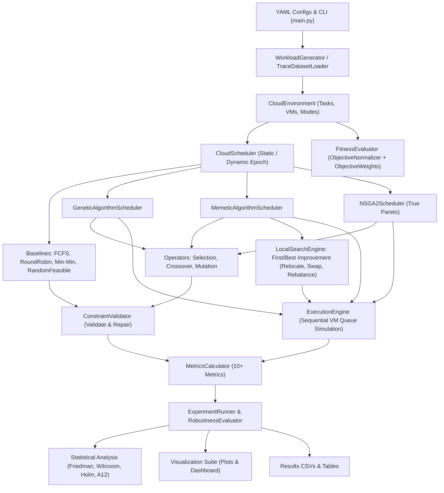
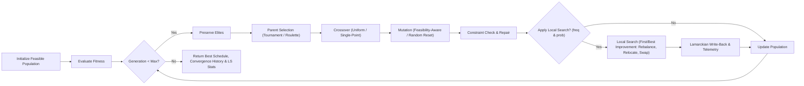

# System Architecture

**Project:** Cloud Resource Allocation Using Genetic Algorithm (GA) and Memetic Algorithm (MA)  
**Courses:** AI310 & CS361 (Fall Semester 2026–2027)

---

## 1. Architectural Design Principles

The simulator and optimization workbench follow a layered, modular architecture separating domain state, constraint physics, execution simulation, optimization solvers, evaluation/statistical pipelines, and reporting/visualization:

1. **Immutability & Determinism:** `Task` and `VirtualMachine` are frozen dataclasses; `CloudEnvironment` precomputes canonical NumPy arrays and deterministic execution ordering (`exec_order`).
2. **Explicit Separation of Simulation vs. Optimization:** Every solver produces an integer assignment vector `x[i] in {0, ..., M-1}`. Execution timelines and resource checks are performed exclusively by `ExecutionEngine` and `ConstraintValidator`—no algorithm computes or mocks its own metrics.
3. **Fairness by Construction:** All baselines, GA, MA, and NSGA-II receive identical `CloudEnvironment` instances, identical `FitnessEvaluator` normalizers/weights, and isolated RNG seeds.
4. **Configurability & Extensibility:** All hyperparameters, workload distributions, and experimental grids reside in `config/default_config.yaml` and `config/experiment_config.yaml`.

---

## 2. High-Level System Architecture Diagram

---

## 3. Memetic Algorithm Hybridization Workflow

---

## 4. Module Directory Map

| Layer | Directory / File | Responsibility |
| :--- | :--- | :--- |
| Domain | `src/models/` (`task.py`, `virtual_machine.py`, `cloud_environment.py`) | Immutable domain models, hardware compatibility matrix, canonical execution ordering |
| Simulation | `src/simulation/` (`execution_engine.py`, `workload_generator.py`, `dataset_loader.py`, `scheduler.py`) | Deterministic sequential VM queue execution, synthetic distributions, Google/Alibaba CSV adapters, static vs. dynamic epoch orchestration |
| Optimization | `src/optimization/` (`constraints.py`, `objectives.py`, `fitness.py`, `local_search.py`) | Hard constraint verification/repair, instance-anchored objective normalization, weighted-sum fitness, First/Best improvement neighborhood search |
| Algorithms | `src/algorithms/` (`base.py`, `baseline.py`, `operators.py`, `genetic_algorithm.py`, `memetic_algorithm.py`, `nsga2.py`) | Baselines, GA, MA, and genuine NSGA-II Pareto optimizer |
| Evaluation | `src/evaluation/` (`metrics.py`, `experiments.py`, `statistics.py`, `robustness.py`) | 10+ mathematical metrics, multi-seed experiment runner, non-parametric tests, stress scenarios |
| Visualization | `src/visualization/` (`plots.py`, `dashboard.py`) | Publication-grade Matplotlib/Seaborn figures and executive summary dashboard |
| Utilities | `src/utils/` (`config_loader.py`, `random_utils.py`, `logging_utils.py`, `validation.py`) | Reproducible RNG management, YAML merging, strict input validation |
